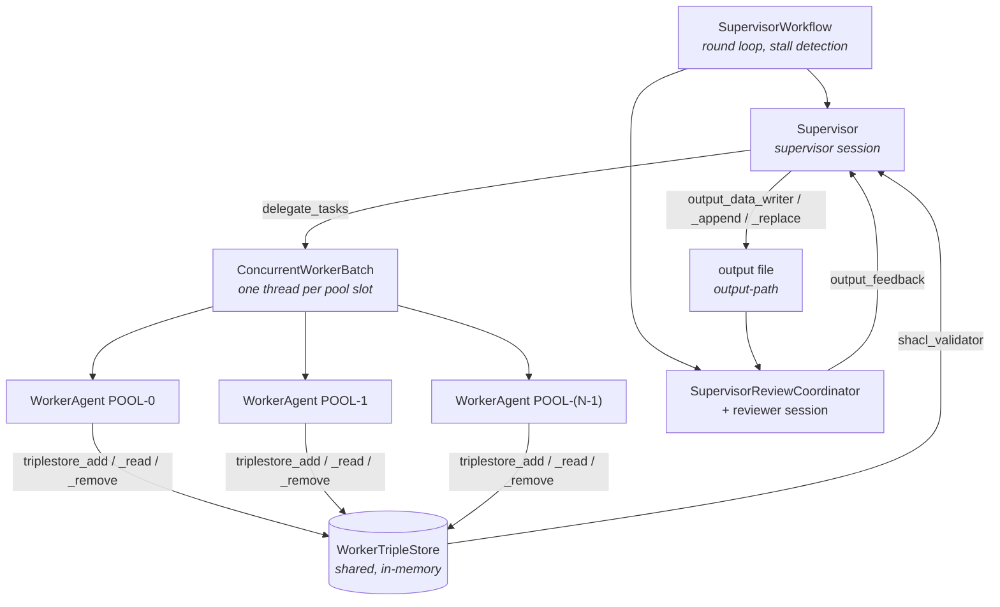
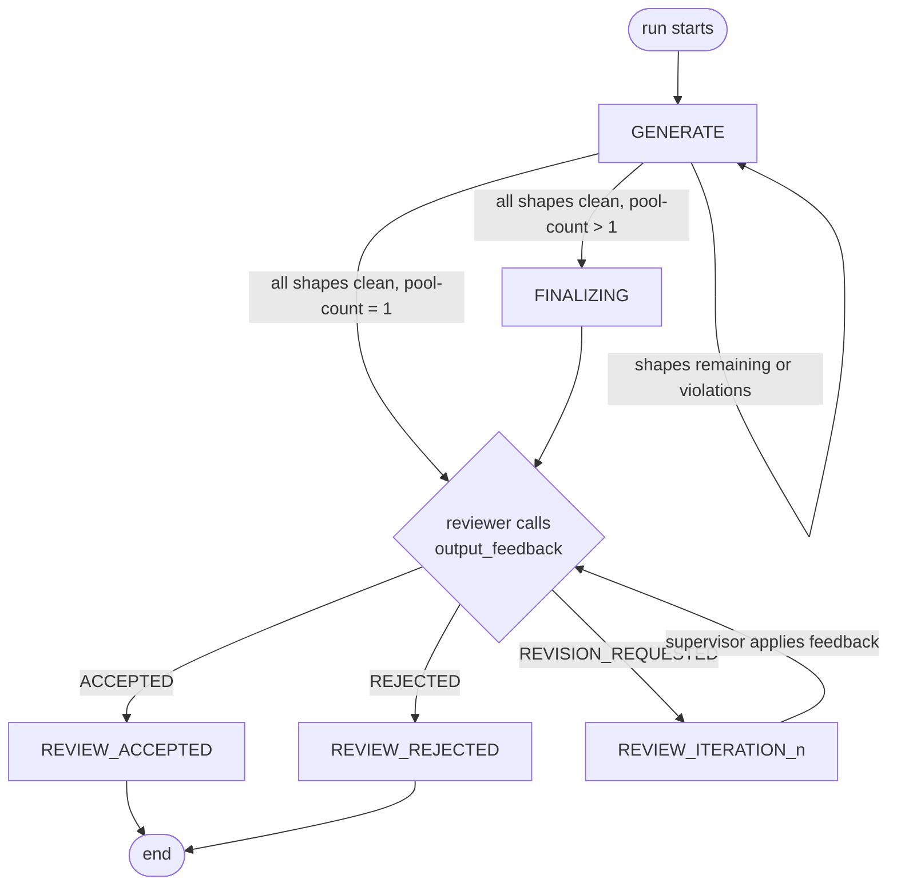
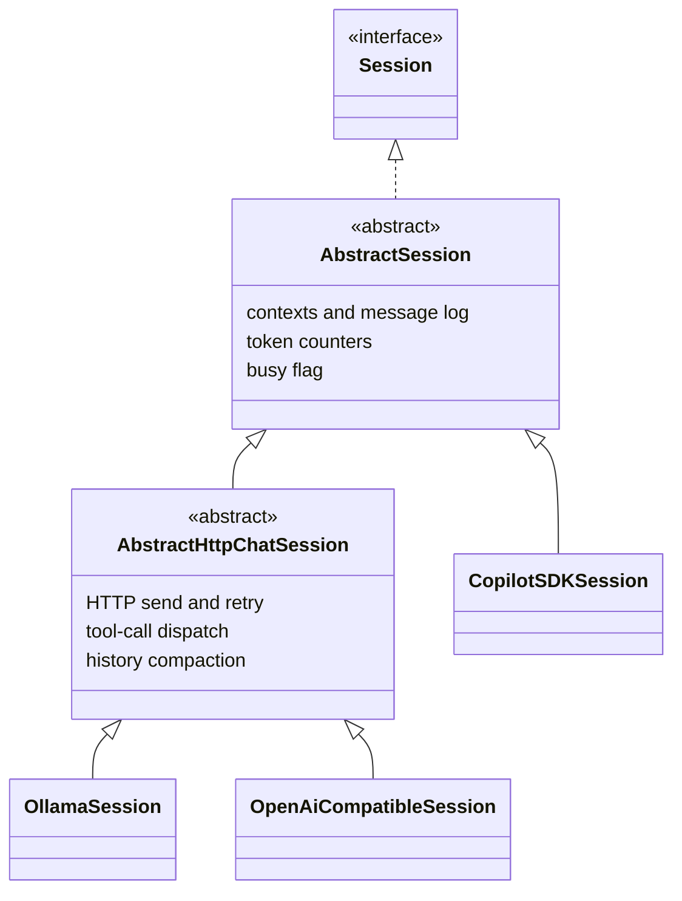

# Architecture

## Overview

OWL-SDA follows a **multi-agent supervisor-worker** pattern. A central `SupervisorWorkflow` drives
the generation pipeline and coordinates three kinds of LLM agent — a supervisor, a pool of workers,
and a reviewer — around one shared RDF triple store.



Alongside the pipeline, two optional components observe the run:

| Component | Purpose |
|-----------|---------|
| `BenchmarkService` (package `benchmark`) | Captures snapshots of every stage to `benchmark.output-dir`. See [Benchmarking](./benchmarking). |
| `WebUiServer` (package `webui`) | Serves a local dashboard over the benchmark output directory, started with `--web-ui`. See [Web UI](./web-ui). |

## Generation pipeline

### 1. Initialisation (`OWLSDA`)

- The input OWL ontology is loaded from `input-path`.
- External ontologies referenced via `owl:imports` are fetched and cached by `OntologyExtractor`.
- An optional reasoner (`OntologyReasoner`) is applied, producing an inferred model.
- SHACL shapes are generated by `Shacl.fromOntology` for both the base model (`defaultShacl`) and
  the inferred model (`inferredShacl`). With a blank `shacl.output-dir` the shapes stay in memory;
  otherwise they are cached to and reloaded from `default-shacl.ttl` and `inferred-shacl.ttl`.
- Sessions (worker pool, supervisor, reviewer) are created by `SessionManager`, which also owns the
  shared `WorkerTripleStore`, the shared `RunMemoryStore`, and one `Client` per distinct provider.
- Contexts are published: an "Ontology Summary" plus the full ontology. When
  `ontology.provide-full-to-workers` is `false`, the full ontology goes to the supervisor and
  reviewer only, and workers see the summary alone.

The reviewer session is created lazily on first use, since review only starts after a complete
generation pass.

### 2. Generation rounds (`SupervisorWorkflow`)

Each round calls `Supervisor.orchestrate(shapes, firstPass)`:

1. **Delegation** — `WorkerDelegationContextManager` clears last round's delegation instructions and
   progress reports, then the supervisor is prompted with the unprocessed shapes and the current
   validation report. It calls `delegate_tasks` once per worker; `SessionManager` routes each call
   to the matching `POOL-N` session.
2. **Worker execution** — `ConcurrentWorkerBatch` runs one `WorkerAgent` per pool slot on a fixed
   thread pool, monitoring for stuck workers. Each worker writes into the shared triple store.
3. **Completion evaluation** — `ShapeCompletionEvaluator` checks which shapes now have instances and
   no remaining class-related violations; `WorkerProgressReportParser` additionally marks shapes that
   a worker's structured progress report claims as conforming. `WorkerResponsePublisher` publishes a
   digest of what each worker did back onto the supervisor session.
4. **Scope expansion** — once shapes start passing validation, the delegation scope grows by
   `batch-size × pool-count` per round, up to the total shape count.

The loop is guarded by three independent stall detectors, each aborting the run rather than looping
forever against an LLM that is not progressing:

| Detector | Threshold | Trips when |
|----------|-----------|-----------|
| Empty delegation rounds | 3 | The supervisor delegated to zero workers. |
| No-progress rounds | 5 | Neither the completed-shape count nor the violation count improved. |
| Stalled violation rounds | 4 | Violations remain and their signature (the set of focus nodes) is unchanged. |

If every shape is marked processed but violations remain, `ShapeValidationMatcher` reopens the
violating shapes for another delegated repair round instead of proceeding.

### 3. Finalisation

When all shapes are processed and validation is clean, `runFinalizationWithBenchmark()` asks the
supervisor to edit the assembled output for consistency — but only when more than one worker
contributed:

```java
int poolCount = (config != null) ? config.getPoolCount() : 1;
if (poolCount <= 1 || supervisor == null) {
  return;
}
```

So with `pool-count: 1` the run goes straight from generation to review. Finalisation is retried up
to three times before being logged as failed.

### 4. Review (`SupervisorReviewCoordinator`)

The reviewer session reads the output and must call `output_feedback` with one of:

| State | Meaning |
|-------|---------|
| `ACCEPTED` | Output is ready; the pipeline ends successfully. |
| `REJECTED` | Generation failed; the pipeline ends with an error. |
| `REVISION_REQUESTED` | Feedback is passed back to the supervisor for targeted fixes, then the reviewer is asked again. |

Up to `client.reviewer.max-review-attempts` iterations run (default 3). On the final attempt
`REVISION_REQUESTED` is rejected — the review must end in a terminal decision.



`REVIEW_ITERATION_n` is written as `REVIEW_ITERATION_1`, `REVIEW_ITERATION_2`, and so on. A
background ticker also emits a `LIVE` snapshot every `benchmark.live-interval-seconds` while a round
is in progress, so the dashboard does not look frozen between stage boundaries.

## Session hierarchy

Every provider integration shares the same bookkeeping — context storage and dedup, token counters,
busy flag, message log — through `AbstractSession`. The two HTTP chat-completions providers share a
second layer that adds the request/retry loop, tool-call dispatch, and history compaction.



`CopilotSDKSession` extends `AbstractSession` directly because the Copilot SDK exposes its own
session and event model rather than a chat-completions endpoint — which is also why
`compaction.copilot-enabled` defaults to `false` while the two HTTP providers default to `true`.

## Key classes

| Class | Package | Role |
|-------|---------|------|
| `OWLSDA` | root | Top-level orchestrator; loads the ontology, builds shapes, wires all components. |
| `SupervisorWorkflow` | generation | Drives the round loop, stall detection, finalisation, and review. |
| `Supervisor` | generation | Delegates shapes to workers, marks completion, edits the final output. |
| `SupervisorReviewCoordinator` | generation | Runs the review loop between the reviewer and the supervisor. |
| `ConcurrentWorkerBatch` | generation | Runs all worker threads for a single delegation round. |
| `WorkerAgent` | generation | Runnable that drives one worker session for one round. |
| `ShapeCompletionEvaluator` | generation | Decides which delegated shapes produced conforming instances. |
| `SessionManager` | agent | Creates and owns every LLM session and its tool handlers. |
| `SessionPool` | agent | Thread-safe pool of worker sessions, addressable as `POOL-N`. |
| `WorkerTripleStore` | agent/handler | Shared in-memory RDF store written to by all workers, with cached SHACL validation. |
| `OntologyExtractor` | ontology | Fetches and caches external ontologies over HTTP. |
| `OntologyReasoner` | ontology | Applies Jena reasoning to derive implicit inferences. |
| `Shacl` | ontology | Generates, loads, saves, and validates SHACL shapes. |
| `BenchmarkService` | benchmark | Captures and persists per-stage benchmark snapshots. |
| `WebUiServer` | webui | Optional local dashboard over the benchmark output directory. |

## Supporting classes

The pipeline classes above delegate most of their detail work to small, single-purpose
collaborators.

### Delegation and worker round-trip (`generation`)

| Class | Role |
|-------|------|
| `WorkerDelegationContextManager` | Clears stale delegation instructions and progress reports at the start of each round, and counts which workers currently hold an active assignment. Worker sessions are deliberately *not* reset, so they keep what they already read; growth is bounded by compaction instead. |
| `WorkerResponsePublisher` | Collects each delegated worker's structured progress report (or its latest message as a fallback) into a single "Worker Responses" digest context on the supervisor session. |
| `WorkerProgressReportParser` | Parses the "Worker Progress Report" context and marks the shapes it claims as completed, ignoring `BLOCKED` reports. |
| `ShapeDistributionFormatter` | Renders the "which shapes go to which worker" block of the supervisor's delegation prompt, including each shape's real target class. |
| `HydraIriTemplateResolver` | Reads a class's `hydra:search` / `hydra:IriTemplate` declaration straight from the ontology so the exact IRI template can be embedded in the delegation text, rather than hoping the model finds it in a large ontology dump. |
| `InstructionFactory` | Loads and caches the instruction templates from resources and substitutes `{{placeholder}}` values. |
| `SessionContextLookup` | Finds a named context inside a session's current context list. |

### Shape and validation state (`generation`)

| Class | Role |
|-------|------|
| `ShapeProcessingTracker` | Tracks which shapes are completed, backing the supervisor's `check_shape_status` tool. It reports totals only — free-text delegation makes per-worker attribution unreliable. |
| `ShapeValidationMatcher` | Maps SHACL report entries back to shapes via their `sh:targetClass`, used to count clean shapes and to reopen shapes that still violate. |
| `DataModelSnapshotResolver` | Answers "what does the data look like right now, and does it conform", preferring the shared store's cached validation snapshot and falling back to re-validating the output file. |

### Session infrastructure (`agent`)

| Class | Role |
|-------|------|
| `AbstractSession` | Shared context storage/dedup, token counters, busy flag, and message log for all sessions. |
| `AbstractHttpChatSession` | Shared HTTP chat-completions plumbing: send/retry, payload and tool-schema building, tool-call dispatch, and history compaction. |
| `HttpRetryExecutor` | Generic exponential-backoff retry helper; the caller supplies the predicate deciding which exceptions are retryable. |

### Benchmark capture (`benchmark`)

`BenchmarkService` is a thin, synchronised facade over three collaborators — the workflow thread and
the live-snapshot ticker both call it, so every read-modify-write happens under one lock:

| Class | Role |
|-------|------|
| `ChangeDetector` | Hashes the observable state (contexts, output, triple store, message logs, token counters, and the stage name) and skips the snapshot when nothing changed. |
| `SnapshotWriter` | Writes `metadata.txt`, per-role context directories, message logs, the triple store dump, and copies of the output and log files. |
| `SnapshotReader` | Reads the freshly written `metadata.txt` and appends it as one entry to the growing `benchmark-summary.json` history. |

## Tool handlers

Each session is equipped with a set of `SessionHandler` implementations the LLM can invoke. There
are 16 in total. Which ones a role actually gets is decided in `SessionManager`, then filtered
per-role by `ToolFilter` against `tools.<role>.enabled` / `tools.<role>.disabled`.

| Tool name | Handler | Worker | Supervisor | Reviewer | Purpose |
|-----------|---------|:------:|:----------:|:--------:|---------|
| `context_reader` | `ContextReaderHandler` | ✅ | ✅ | ✅ | Read the session's own named context entries. |
| `delegate_tasks` | `DelegationHandler` | — | ✅ | — | Publish instructions to a specific `POOL-N` worker. |
| `worker_progress` | `WorkerProgressHandler` | ✅ | — | — | Write a structured progress report context entry. |
| `triplestore_add` | `TripleStoreAddHandler` | ✅ | — | — | Add Turtle triples to the shared store. |
| `triplestore_read` | `TripleStoreReadHandler` | ✅ | — | — | Query triples from the shared store. |
| `triplestore_remove` | `TripleStoreRemoveHandler` | ✅ | — | — | Remove triples from the shared store. |
| `output_data_writer` | `OutputWriterHandler` | — | ✅ | — | Write or overwrite the output file. |
| `output_data_append` | `OutputAppendHandler` | — | ✅ | — | Append to the output file. |
| `output_data_replace` | `OutputReplaceHandler` | — | ✅ | — | Replace specific line ranges in the output file. |
| `output_data_reader` | `OutputReaderHandler` | ✅ | ✅ | ✅ | Read the current output file contents. |
| `shacl_validator` | `OutputValidatorHandler` | ✅ | ✅ | ✅ | Validate data against the SHACL shapes. Workers validate the shared store against the base shapes; the supervisor and reviewer validate the file against the inferred shapes. |
| `check_shape_status` | `ShapeStatusCheckerHandler` | — | ✅ | — | Query how many shapes are completed vs. remaining. |
| `output_feedback` | `OutputFeedbackHandler` | — | — | ✅ | Signal `ACCEPTED` / `REJECTED` / `REVISION_REQUESTED`. |
| `http_call` | `HttpCallHandler` | ✅ | ✅ | ✅ | Fetch a URL through the `HttpAllowlist`. Requires `tools.http.enabled`. |
| `memory_set` | `MemorySetHandler` | ✅ | ✅ | ✅ | Store a note in the shared `RunMemoryStore`, scoped to the calling role. Requires `tools.memory.enabled`. |
| `memory_get` | `MemoryGetHandler` | ✅ | ✅ | ✅ | Read back a note from the shared memory store. Requires `tools.memory.enabled`. |

There is no triple-store clear tool: the three `triplestore_*` tools above are the complete set.

`shacl_validator` and `check_shape_status` are registered only when the corresponding component
exists (SHACL shapes, and the `ShapeProcessingTracker` respectively). See
[Configuration](./configuration) for the `tools.*` keys that gate all of these.

## Observing a run

- [Web UI](./web-ui) — live dashboard of stages, messages, tool calls, the triple store, and trends.
- [Benchmarking](./benchmarking) — the snapshot files on disk and the plotting script.
- [Examples](./examples) — end-to-end runs with real numbers.
