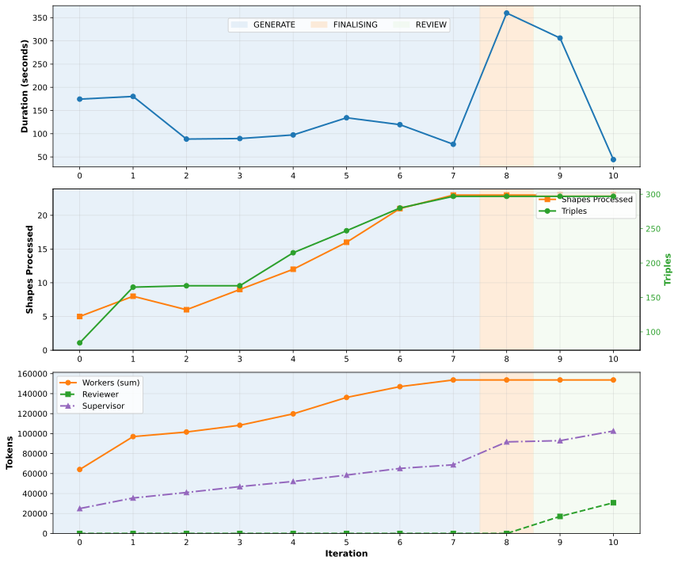
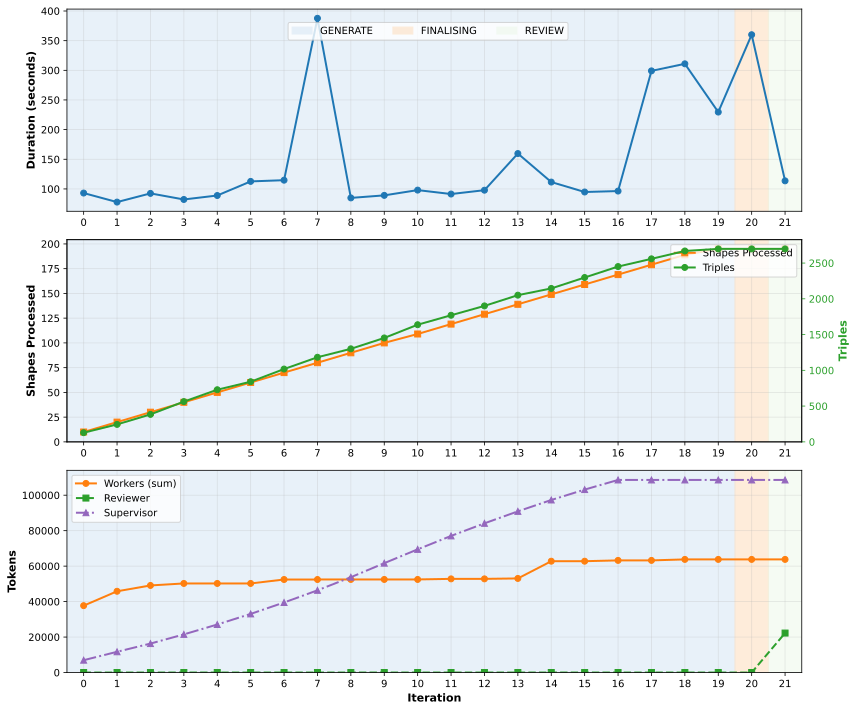

# Benchmarking

OWL-SDA can capture a live snapshot of a run's state - message logs, contexts, triple store - as it happens, giving you full visibility into how the run is progressing without waiting for it to finish. Layout under `output-dir`:

- `output-dir/live/` - the currently in-progress (or most recently finished) run. Its files are overwritten in place every time a snapshot is captured, so you can watch this one folder while a run is happening instead of finding results only after it completes.
- `output-dir/archive/<timestamp>/` - previous runs, moved here (not deleted) the next time a run starts, so history across multiple runs is preserved instead of being silently overwritten.

While a round or review iteration is still in progress, a background ticker captures a snapshot (stage `LIVE`) into `live/` every `live-interval-seconds`, in addition to the snapshot captured at each round/review boundary.

## Enabling Benchmarking

```yaml
benchmark:
  enabled: true
  output-dir: "target/benchmarks"
  live-interval-seconds: 15
```

| Key | Type | Default | Description |
|-----|------|---------|-------------|
| `enabled` | boolean | `false` | Enable benchmark snapshot collection. |
| `output-dir` | string | `target/benchmarks` | Parent directory holding `live/` (the current run) and `archive/` (previous runs). |
| `live-interval-seconds` | long | `15` | How often, in seconds, a `LIVE` snapshot is captured while a round/review iteration is still running. |

At the start of each run, if `output-dir/live/` holds data from a previous run, it's moved to `output-dir/archive/<timestamp>/` (named after that run's last snapshot) before the new run starts writing to a fresh `live/`.

## What Is Captured

All of a run's state lives directly under `live/` (no per-round sub-directories within it) and is overwritten in place on every snapshot:

| File | Description |
|------|-------------|
| `metadata.txt` | Key/value properties for the most recent snapshot only - see below. |
| `triplestore.ttl` | Full contents of the shared triple store at the time of the snapshot. |
| `triplestore-summary.txt` | Triple count and snapshot time. |
| `triplestore-error.txt` | Written *instead of* the summary when serialising the triple store failed; contains the error message. Its presence means `triplestore.ttl` is stale or missing. |
| `supervisor_context/` | All context entries active in the supervisor session, one `.txt` file per context. |
| `reviewer_context/` | All context entries active in the reviewer session. |
| `worker_contexts/worker_N/` | Context entries for each worker session, prefixed `round_N-` once delegation rounds start. |
| `*/Validation Report.txt` | The current SHACL validation report, written inside whichever role's context directory holds it. This is what the dashboard's violations view reads. |
| `message_logs/` | Full JSON message transcripts (`supervisor-messages.json`, `reviewer-messages.json`, `worker_N-messages.json`), as they stand right now. |
| `output.ttl` | Copy of the generated output file at snapshot time (named after your configured `output-path`). |
| `owlsda.log` | Copy of the log file (only when `log-to-file: true`). |
| `benchmark-summary.json` | The one file that is *not* overwritten - see below. |

A snapshot is skipped (nothing is written) when nothing has changed since the previous one - by content hash of the message logs, contexts, triple store, and token counts - so a quiet run doesn't waste writes. Both the round/review-boundary snapshot and the periodic `LIVE` ticker call into the same synchronized write path, so a tick landing right as a round finishes can't corrupt or drop the round's own entry.

### metadata.txt

A flat `key=value` properties file describing the latest snapshot. Beyond the run counters it also records, per role, which model and provider are in use, whether the role is mid-prompt, and how full its context window is - these are the fields the web dashboard's live indicator and context gauge are built on.

| Key | Description |
|-----|-------------|
| `stage` | Stage of this snapshot (see [Stages](#stages)). |
| `shapes_processed` | Number of shapes processed so far. |
| `duration_ms` | Duration of the round or iteration this snapshot closes. |
| `timestamp` | Snapshot id, e.g. `20260409_150145_970`. |
| `triplestore_size` / `triplestore_empty` | Triple count, and whether the store is empty. |
| `current_violations` | Outstanding SHACL violations. |
| `model.<role>` / `provider.<role>` | Model name and effective provider per role (`supervisor`, `reviewer`, `worker`), with the role's provider override resolved against `client.provider`. |
| `tokens.<role>.{input,output,total}` | Cumulative token usage for `supervisor` and `reviewer`. |
| `tokens.worker.worker_N.{input,output,total}` | Cumulative token usage per worker. |
| `busy.<role>` | `true` while that role is waiting on a model call. Worker keys are `busy.worker.worker_N`. |
| `context.<role>.used` | Prompt tokens of that role's **last** call - a point-in-time figure, not a cumulative sum. |
| `context.<role>.limit` | The role's configured `context-window-tokens` (`0` when unset). |

## JSON Summary

Every snapshot appends one entry to `live/benchmark-summary.json` - this is the one file in the run that grows over time rather than being overwritten, because it's what preserves progress-over-time history for plotting even though the rest of the run directory only ever shows the latest state:

```json
[
  {
    "timestamp": "20260409_140831_530",
    "stage": "GENERATE",
    "shapesProcessed": 10,
    "durationMs": 93059,
    "triplestoreSize": 128,
    "triplestoreEmpty": false,
    "currentViolations": 0,
    "tokens": {
      "workers": {
        "worker_0": { "input": 0, "output": 0, "total": 8363 },
        "worker_1": { "input": 0, "output": 0, "total": 7042 }
      },
      "reviewer": { "input": 0, "output": 0, "total": 0 },
      "supervisor": { "input": 0, "output": 0, "total": 6946 }
    }
  }
]
```

Every token figure - workers, reviewer, and supervisor alike - is an object with `input`, `output`, and `total`. Providers that don't report a directional split leave `input` and `output` at `0` and only fill `total`.

Older summaries look different: they store each role's tokens as a bare integer (`"supervisor": 24990`) and carry an extra `snapshotDirectory` field that current runs no longer write. `examples/project-1/benchmark_paper/benchmark-summary.json` is in that older shape; `examples/project-2/benchmark_paper/benchmark-summary.json` uses the nested one. The plotting script accepts both.

## Stages

| Stage | When it occurs |
|-------|---------------|
| `LIVE` | Every `live-interval-seconds` while a round/review iteration is still in progress. |
| `GENERATE` | After each supervisor delegation round. |
| `FINALIZING` | After the supervisor finalises the assembled output for consistency. |
| `REVIEW_ITERATION_<n>` | After review iteration `n` completes without a verdict, e.g. `REVIEW_ITERATION_1`. |
| `REVIEW_ACCEPTED` | When the reviewer signals ACCEPTED. |
| `REVIEW_REJECTED` | When the reviewer signals REJECTED. |

Those six are the complete set - there is no plain `REVIEW` stage. The plotting script groups every `REVIEW_*` stage under a single "REVIEW" band when colouring its charts, which is presentation only.

## Watching a Run Live

Pass `--web-ui` to watch messages, tool calls, stages, and output in a browser instead of reading these files by hand. It reads `benchmark.output-dir/live` straight from disk on every request, so it needs `benchmark.enabled: true`:

```bash
java -jar target/owlsda.jar --config config.yml --web-ui
```

See [Web UI](./web-ui) for what the dashboard shows, and [Command Line Interface](./cli) for the related options.

## Visualising Results

`scripts/plot_benchmark.py` turns a run's `benchmark-summary.json` into charts and summary statistics. It takes **no positional argument** - point it at a *directory* containing `benchmark-summary.json`:

```bash
# a specific run directory
python scripts/plot_benchmark.py --benchmark-dir examples/project-2/benchmark_paper

# every examples/*/benchmark_paper directory in one go
python scripts/plot_benchmark.py --all

# also open the chart in an interactive window
python scripts/plot_benchmark.py --benchmark-dir target/benchmarks/live --show
```

| Option | Default | Description |
|--------|---------|-------------|
| `--benchmark-dir` | `../examples/project-2/benchmark_paper` | Directory holding `benchmark-summary.json`. Relative paths are resolved against the repository root, and a leading `../` is stripped, so the same value works from the repo root or from `scripts/`. |
| `--all` | off | Process every `examples/*/benchmark_paper` directory instead of a single one. |
| `--show` | off | Display the chart interactively as well as saving it. Without it, a non-interactive backend is used. |

It writes five files **into that same directory**:

| File | Contents |
|------|----------|
| `benchmark_plot.png` | Three stacked charts (duration, shapes/triples, tokens) at 150 dpi. |
| `benchmark_plot.svg` | The same chart as vector graphics. |
| `benchmark_plot.pdf` | The same chart as a PDF with embedded TrueType fonts. |
| `benchmark_stats.txt` | Human-readable totals: iteration count, total/mean/median/min/max duration, shape and triple counts, shapes per second, and per-role token totals. |
| `benchmark_stats.json` | The same statistics as JSON. |

Requires Python 3 with `matplotlib`.

## About the Bundled `benchmark_paper` Directories

`examples/project-N/benchmark_paper/` is a hand-curated snapshot kept for the paper, produced by an **earlier version** of OWL-SDA (see each directory's `NOTE.txt`). It uses the old flat layout - one directory per snapshot at the top level - from before `live/` and `archive/` existed, so it is not what a run produces today.

Actual runs write to whatever you configure as `benchmark.output-dir`; for the bundled examples that is `examples/project-N/benchmark/`, which is gitignored. Use `benchmark_paper/` as reference data for the plotting script, not as a description of the current output layout.

### Example benchmark chart - Project 1



### Example benchmark chart - Project 2



The numbers behind these charts are discussed in [Examples](./examples).
