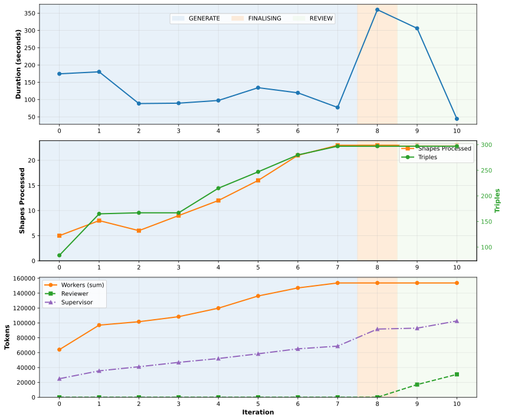
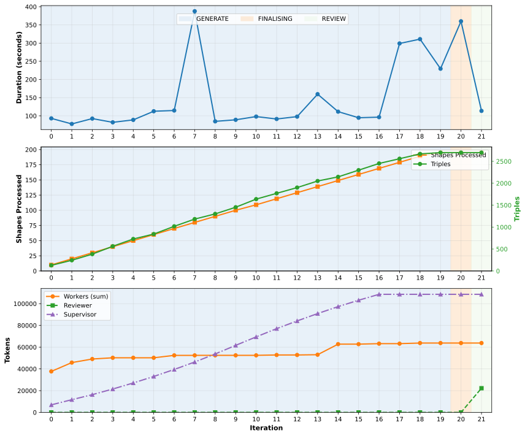

# Examples

The repository includes three complete example projects that you can run as-is.

Every invocation needs an explicit `--config`; the option has no default. Build the jar first (see [Installation](./installation)) — `mvn clean package` produces `target/owlsda.jar`.

::: warning A run overwrites the example's output
OWL-SDA deletes the file at `output-path` before it starts, and archives any previous benchmark directory. Point `output-path` somewhere else first if you want to keep what is already there.
:::

## Project 1 - Glass Production Facility

`examples/project-1/` demonstrates a production-process ontology with temporal variants.

### What it generates

Given the prompt:

> *"Create a data example for a glass production facility. Introduce multiple versions of the operation in different years with different systems, processes and subprocesses."*

OWL-SDA generates RDF instances for facilities, systems, processes, and subprocesses across multiple years, illustrated using a glass manufacturing scenario (installations like furnaces, processes such as melting/annealing, and measurement points for emissions).

The config also shows off `context-window-tokens`, an `openai-compatible` provider pointed at a self-hosted gateway, and a long list of `extract.mirrors` for external ontologies.

### Running the example

```bash
java -jar target/owlsda.jar --config examples/project-1/config.yml
```

### Key files

| File | Description |
|------|-------------|
| `examples/project-1/config.yml` | Run configuration. |
| `examples/project-1/input.ttl` | OWL ontology used as generation input. |
| `examples/project-1/input-example.txt` | Extra user context passed to the agents. |
| `examples/project-1/reasoner.rules` | Custom Jena rules for the [reasoner](./reasoner). |
| `examples/project-1/shacl/` | Cached SHACL shapes (`default-shacl.ttl`, `inferred-shacl.ttl`), reused across runs. |
| `examples/project-1/benchmark_paper/` | Curated benchmark snapshot used for the plots below. |

A run additionally writes `output.ttl` (the generated triples), `inferred.ttl` (the reasoner's inferred model), `external/` (cached external ontologies) and `benchmark/` (snapshots) into `examples/project-1/`. None of these are shipped in the repository.

## Project 2 - Patient History Record

`examples/project-2/` demonstrates richer generation on a larger medical ontology input.

### What it generates

Given the prompt:

> *"Create a patient history record for the ontology."*

OWL-SDA generates linked patient history data aligned with the classes and properties in `owlapi.xrdf`.

This config mixes providers: `ollama` workers with a `copilot` supervisor and reviewer.

### Running the example

```bash
java -jar target/owlsda.jar --config examples/project-2/config.yml
```

### Key files

| File | Description |
|------|-------------|
| `examples/project-2/config.yml` | Run configuration. |
| `examples/project-2/owlapi.xrdf` | Main ontology input (RDF/XML). |
| `examples/project-2/2504.08750v1.pdf` | Domain paper passed as user context. |
| `examples/project-2/reasoner.rules` | Custom Jena rules for the reasoner. |
| `examples/project-2/shacl/` | Cached SHACL shapes. |
| `examples/project-2/output.ttl` | Output kept from an earlier run, so you can inspect the result without running anything. **Deleted at the start of your next run.** |
| `examples/project-2/benchmark_paper/` | Curated benchmark snapshot used for the plots below. |

`inferred.ttl`, `external/` and `benchmark/` appear here after a run; they are not shipped.

## Project 3 - LDES Parking Garage Observations

> Work in progress - not fully benchmarked yet.

`examples/project-3/` demonstrates LDES-oriented dummy data generation for parking availability observations. It also showcases **URL-based user context**: the LDES specification is fetched live from the web at runtime rather than loaded from a local file.

### What it generates

Given the prompt:

> *"Generate dummy LDES data for a parking garage with observations about available spaces over time."*

OWL-SDA generates parking observation instances linked to a stream resource, with timestamps and availability values aligned to the ontology constraints.

### Running the example

```bash
java -jar target/owlsda.jar --config examples/project-3/config.yml
```

### Key files

| File | Description |
|------|-------------|
| `examples/project-3/config.yml` | Config using both local and URL-based user context (`https://semiceu.github.io/LinkedDataEventStreams/`). |
| `examples/project-3/input.ttl` | Main ontology input for parking and observation terms. |
| `examples/project-3/input-example.txt` | Domain constraints passed as extra context. |
| `examples/project-3/reasoner.rules` | Empty placeholder — the reasoner runs without custom rules. |
| `examples/project-3/shacl/` | Empty until the first run generates and caches the shapes. |
| `examples/project-3/output.ttl` | Empty placeholder; filled by a run. |

`inferred.ttl`, `external/` contents and `benchmark/` are likewise produced by a run.

## Benchmark Result Images

The plots below are generated from each example's `benchmark-summary.json` with `scripts/plot_benchmark.py`.

Benchmark time is calculated as the sum of `durationMs` for all iterations **except the final `REVIEW_*` iteration**, because that final review snapshot is already an aggregate of the review stages.

::: tip
`examples/project-N/benchmark_paper/` is a hand-curated snapshot kept for the paper. It was produced by an earlier version of OWL-SDA and uses a flat layout; a run today writes `live/` and `archive/<timestamp>/` under `benchmark.output-dir` instead. See [Benchmarking](./benchmarking).
:::

### Project 1 benchmark

**Glass Production Facility** · 11 rounds · ~27.9 min total · 297 final triples · 0 violations at acceptance · ~2.1M tokens



[PNG fallback](/benchmarks/project-1-benchmark.png)

### Project 2 benchmark

**Patient History Record** · 22 rounds · ~54.8 min total · 2,698 final triples · 0 violations at acceptance · ~2.7M tokens



[PNG fallback](/benchmarks/project-2-benchmark.png)

## Compare the benchmark raw data

- `examples/project-1/benchmark_paper/benchmark-summary.json`
- `examples/project-2/benchmark_paper/benchmark-summary.json`
- `examples/project-1/benchmark_paper/benchmark_stats.txt`
- `examples/project-2/benchmark_paper/benchmark_stats.txt`

Watch a run of your own live in the browser with `--web-ui` — see the [Web UI](./web-ui) guide.
