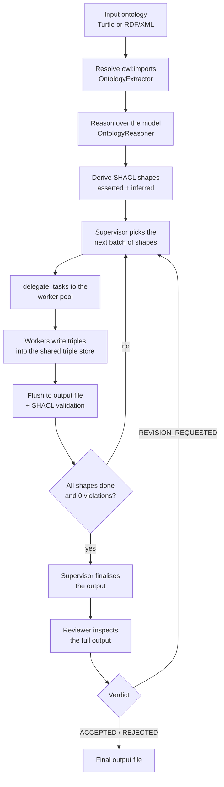

# Introduction

**OWL-SDA** (OWL Synthetic Data AI-Agent) is a Java tool that generates synthetic RDF instance data from OWL ontologies using Large Language Models (LLMs).

Given an input ontology (in Turtle or RDF/XML format) and a natural-language prompt describing the desired data, OWL-SDA:

1. Loads and optionally reasons over the ontology (including fetching external imports).
2. Derives SHACL shapes from the OWL class descriptions.
3. Dispatches a **supervisor** agent that coordinates a pool of **worker** agents, each responsible for generating instances for a subset of SHACL shapes.
4. Validates the generated triples against the SHACL shapes after each round.
5. Passes the final output to a **reviewer** agent that either accepts it or requests targeted revisions.

## How a run flows

The generation loop is bounded: consecutive rounds that delegate to nobody, make no progress, or leave the same violations untouched abort the run instead of looping forever. Review iterations are capped by `client.reviewer.max-review-attempts`, and the last attempt must end in ACCEPTED or REJECTED.

## Key Concepts

### Agents

| Role | Responsibility |
|------|---------------|
| **Supervisor** | Orchestrates the generation loop, assigns shapes to workers, and finalises the output. |
| **Worker (pool)** | Generates RDF triples for its assigned shapes and writes them to the shared triple store. |
| **Reviewer** | Reviews the fully assembled output and signals ACCEPTED, REJECTED, or REVISION_REQUESTED. |

Each role has its own model, timeouts, and tool permissions. See the [Configuration Reference](./configuration) and [Architecture](./architecture).

### SHACL Shapes

OWL-SDA automatically generates [SHACL](https://www.w3.org/TR/shacl/) NodeShapes from `owl:Class` definitions, including property shapes derived from `owl:Restriction` axioms. These shapes are used both to guide the workers and to validate the output after each generation round. Shapes are derived twice — from the asserted model and from the [reasoner](./reasoner)'s inferred model — and can be cached to disk via `shacl.output-dir`.

### Triple Store

Workers write triples directly into a shared in-memory triple store. After each delegation round the store is flushed to the configured output file so that the supervisor and reviewer can read it.

### User Context

Any number of local files or live URLs can be attached as extra context for the agents — domain notes, worked examples, a PDF, or a specification fetched at runtime. External ontologies referenced through `owl:imports` are fetched, mirrored, and cached separately; see [External Ontologies](./external-ontologies).

## Observing a run

Runs are long, so OWL-SDA can show you what it is doing while it works:

- **Benchmark snapshots** capture every round — duration, shapes processed, triple count, violations, per-role token usage, and the full message log. See [Benchmarking](./benchmarking).
- **A built-in web dashboard**, started with `--web-ui`, reads those snapshots live and serves them at `http://localhost:8080`: agent messages and tool calls, the generated output, the triple store, trend charts, and a SHACL violations view. It needs `benchmark.enabled: true` to have anything to show. See [Web UI](./web-ui).

## Supported LLM Backends

OWL-SDA supports **GitHub Copilot** (via the standalone Copilot CLI), **Ollama** (self-hosted models), and any **OpenAI-compatible endpoint** (bring-your-own-key — OpenAI itself, Azure OpenAI, or self-hosted gateways) as language model backends. Providers can be mixed per role: cheap local workers with a stronger hosted supervisor, for example. Support for additional providers can be added by implementing the `Client` / `Session` interfaces.

## Next Steps

- [Installation](./installation) — build the jar and set up a backend.
- [Quick Start](./quickstart) — a first run on a minimal ontology.
- [Examples](./examples) — three complete, ready-to-run projects.

## License

OWL-SDA is distributed under the **GNU General Public License v3.0**. See [License](./license) for details and the full license text.
