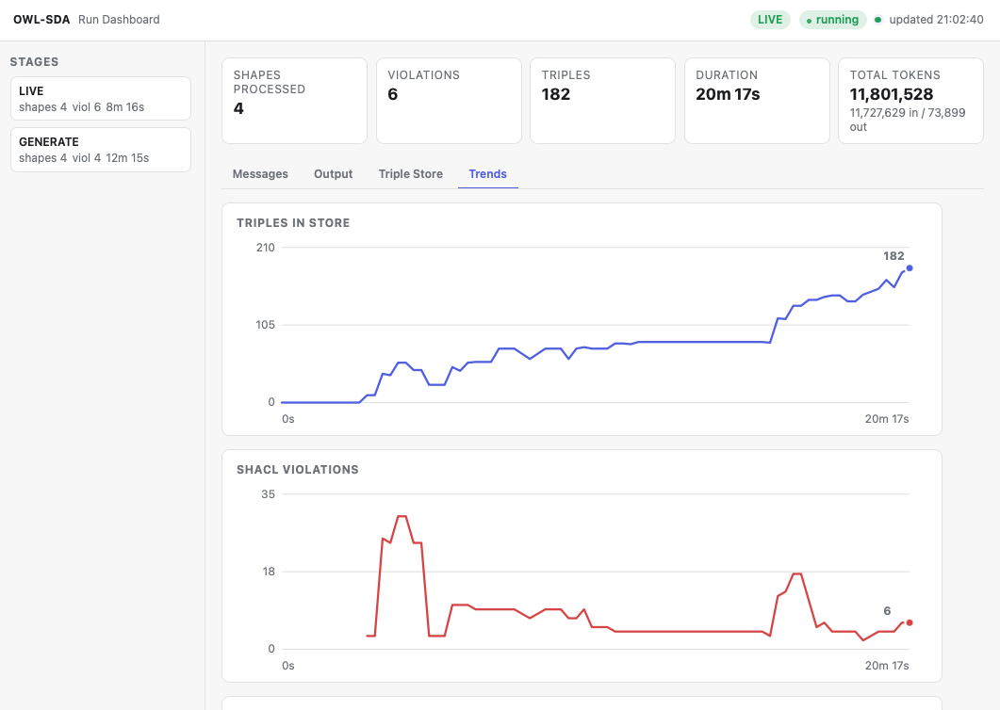
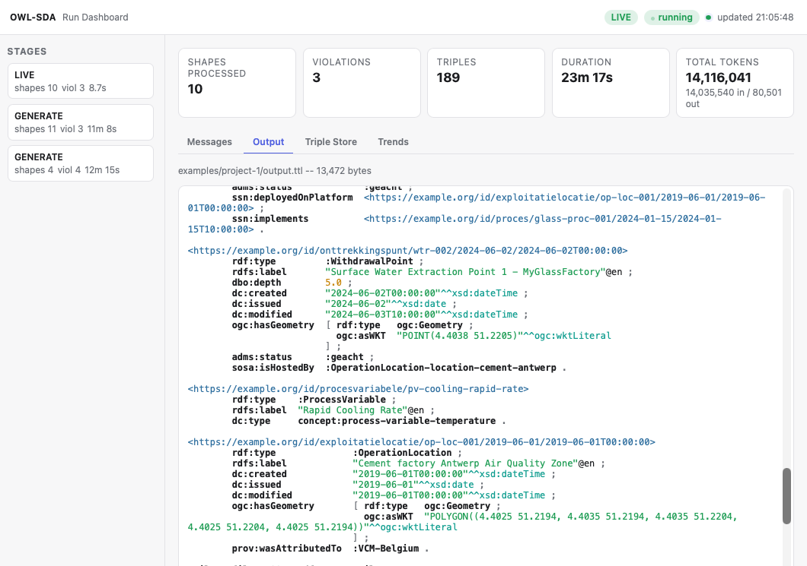

# Web UI

OWL-SDA ships with an opt-in local dashboard that shows a run as it happens: the stage timeline,
every agent's messages and tool calls, the shared triple store, the output file, and trend charts
for triples, violations, and shapes over time.

The dashboard is read-only. It renders the benchmark output directory from disk, so it never
interferes with the run.

## Starting it

```bash
java -jar target/owlsda.jar --config examples/project-1/config.yml --web-ui
```

| Option | Default | Notes |
|--------|---------|-------|
| `--web-ui` | off | Starts the dashboard on `http://localhost:8080`. |
| `--web-ui-port` | `8080` | Port to listen on. |

The dashboard reads the benchmark output, so **`benchmark.enabled: true` must be set in your
config** — without it the page shows a "Waiting for benchmark data…" placeholder and OWL-SDA logs a
warning at startup. See [Configuration](./configuration) for `benchmark.enabled`,
`benchmark.output-dir`, and `benchmark.live-interval-seconds`.

The server keeps serving after the run finishes:

```
Run finished. Web UI still available at http://localhost:8080 -- press Ctrl+C to exit.
```

Press `Ctrl+C` when you are done inspecting the results.

The page polls every 2.5 seconds. How often the underlying data changes is set by
`benchmark.live-interval-seconds` (default 15), which controls how often a `LIVE` snapshot is
flushed while a round is still running.

## The dashboard



### Header and stat row

The header carries the current stage badge (`LIVE`, `GENERATE`, `FINALIZING`,
`REVIEW_ITERATION_<n>`, `REVIEW_ACCEPTED`, `REVIEW_REJECTED`), a running/idle indicator, a server
connection dot, and the last refresh time. A run counts as "running" when the newest snapshot is
younger than three live intervals (at least 30 seconds).

Five stat cards sit above the tabs: **Shapes Processed**, **Violations**, **Triples**, **Duration**,
and **Total Tokens** (with an input/output split underneath). Duration is measured from the first
snapshot of the run, not from the current stage.

The **Violations** card is clickable — it opens a modal with the full SHACL validation report,
backed by `/api/violations`. Press `Escape` or click outside to close it.

### Stages sidebar

Every snapshot in `benchmark-summary.json` appears as a row with its shape count, violation count,
and duration, newest first. Consecutive `LIVE` ticks are collapsed into a single row with a
multiplier, so only real milestones plus one "still working" entry are shown.

### Tabs

| Tab | What it shows |
|-----|---------------|
| **Messages** | One sub-tab per session role (`supervisor`, `reviewer`, `worker_0`, `worker_1`, …). Shows that role's full transcript with tool calls and their results merged into single cards, Turtle syntax highlighting, collapsible long bodies, and an auto-scroll toggle. Above the transcript, the role's current named contexts ("Delegation Instructions", "Validation Report", "Ontology Summary", …) are shown as collapsible panels. |
| **Output** | The current contents of the file at `output-path`, with size and Turtle highlighting. |
| **Triple Store** | The shared `WorkerTripleStore` dump (`triplestore.ttl`) from the latest snapshot. |
| **Trends** | Three line charts over the run's elapsed time: **Triples in store**, **SHACL violations**, and **Shapes processed**. Hovering shows a crosshair and a tooltip with the value and how far into the run it was. Unmeasured points (for example violations before the first validation) break the line rather than being plotted as zero. |



### Live per-role indicators

Each role sub-tab in the Messages tab carries three live figures:

- A **busy dot** — whether that session is currently mid-prompt.
- The **model name**, with the provider in its tooltip.
- A **context usage percentage**, shown only when a context window is configured.

These come from `metadata.txt`, which `SnapshotWriter` refreshes on every snapshot:

| Field | Meaning |
|-------|---------|
| `model.<role>` | Configured model for the role. |
| `provider.<role>` | Effective provider, falling back to `client.provider` when the role sets none. |
| `busy.<role>` | Whether the session is currently waiting on the model. |
| `context.<role>.used` | Prompt tokens on the **last** completed call — not a cumulative total. |
| `context.<role>.limit` | The role's `context-window-tokens`. Zero means unset, and the gauge is hidden. |

`<role>` is `supervisor`, `reviewer`, or `worker.worker_N`. Model and provider are written once per
role rather than per worker index, since all pool workers share one configured model. Set
`client.<role>.context-window-tokens` in the config to get a usage gauge at all.

## HTTP API

The dashboard is a static page over a small JSON API served by `WebUiServer`. All endpoints are
`GET`, take no authentication, and are stable enough to script against.

| Route | Returns |
|-------|---------|
| `/` | The dashboard itself (`index.html`, `app.js`, `style.css` — a fixed allowlist, no filesystem traversal). |
| `/api/state` | `{ benchmarkEnabled, benchmarkDirExists, liveIntervalSeconds, metadata, roles }`. `metadata` is `metadata.txt` as a flat object; `roles` lists the session roles that have a message log, ordered supervisor, reviewer, then `worker_0`… |
| `/api/history` | The raw `benchmark-summary.json` array — one entry per snapshot, with `stage`, `timestamp`, `shapesProcessed`, `currentViolations`, `triplestoreSize`, `durationMs`, and token counts. `[]` before the first snapshot. |
| `/api/messages?role=<role>` | That role's message log. `TOOL_INVOCATION` entries are enriched with a parsed `tool: { name, arguments, argumentsAreJson }`. `404` with `{"error":"unknown role"}` for an unknown role. |
| `/api/contexts?role=<role>` | `[{ name, content }]` for the role's current named contexts. Files from earlier rounds (prefixed `round_N-`) are excluded, so this is the round in progress only. |
| `/api/triplestore` | `triplestore.ttl` as `{ path, exists, sizeBytes, truncated, content }`. |
| `/api/output` | The file at `output-path`, same shape as above. |
| `/api/violations` | The most recent `Validation Report.txt` held by any role (supervisor and reviewer are checked first), same shape as above. |

The three file endpoints truncate content at 2,000,000 characters and set `truncated: true` when
they do.

Example:

```bash
curl -s http://localhost:8080/api/state | jq '.metadata.stage, .roles'
curl -s http://localhost:8080/api/history | jq '.[-1]'
curl -s http://localhost:8080/api/messages?role=worker_0 | jq '[.[] | select(.tool) | .tool.name]'
```

## Where the data comes from

Everything the dashboard shows is read from `<benchmark.output-dir>/live/` — the same directory
`BenchmarkService` overwrites in place as the run progresses. Nothing is cached in the server, so
restarting the dashboard against a finished run's directory replays it exactly.

See [Benchmarking](./benchmarking) for the full snapshot layout, the archived runs under
`archive/<timestamp>/`, and the offline plotting script.
